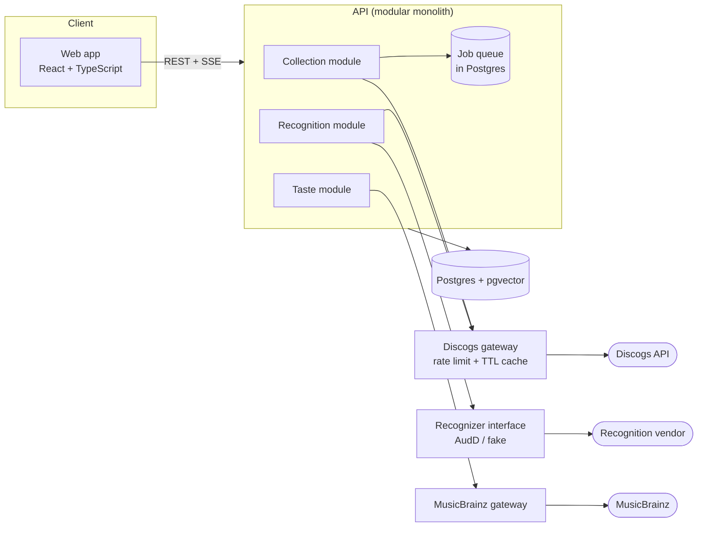

# Vinyl Shelf (working title)

A web app for vinyl collectors: browse your Discogs collection in a polished, tactile UI,
identify what's playing and add the pressing to your shelf, and discover music you're
likely to love but wouldn't have found yourself.

> **Status:** first vertical slice complete: Discogs login, a resumable collection
> import and a functional shelf view, verified against a real Discogs account. Visual
> polish, recognition and the taste engine are next (see Roadmap).

## Goals

This project is also a demonstration of engineering practice:

- Contract-first API design
- Clear module boundaries around every external service
- Documented decisions (see `docs/adr/`)
- Tests that never call live third-party APIs
- Free to build and host

## Architecture



Key ideas:

- **Modular monolith**: separate modules with explicit interfaces; extract a service only
  when there is a concrete reason (for example a Python worker for audio features).
- **Gateways for every vendor**: Discogs, the recognition vendor and MusicBrainz sit behind
  our own interfaces, so a vendor change touches one module.
- **Results by event stream**: recognition outcomes arrive over SSE so that a future
  phone-pairing feature needs no redesign.

## Getting started

Requirements: Node 22.12+, pnpm (version pinned in `package.json`; `corepack enable`
provides it), Docker, and a Discogs app from
[discogs.com/settings/developers](https://www.discogs.com/settings/developers) with its
callback URL set to `http://localhost:3000/api/v1/auth/discogs/callback`.

```sh
cp .env.example .env      # fill in the Discogs keys and TOKEN_ENCRYPTION_KEY
docker compose up -d      # Postgres with pgvector
pnpm install
pnpm --filter @vinylshelf/api db:migrate
pnpm dev                  # API on :3000, web app on http://localhost:5173
```

| Command | What it does |
|---|---|
| `pnpm check` | Contract staleness check, lint, format check, typecheck and all tests (what CI runs) |
| `pnpm --filter @vinylshelf/contract generate` | Regenerate types after editing `openapi.yaml` |
| `pnpm --filter @vinylshelf/api fixtures:check` | Compare the Discogs test fixtures with the live API (shapes only, never values) |

Tests never call live third-party APIs: Discogs is served from fixtures through MSW, and
any unmocked request fails the test.

## Repository layout

```
apps/web            Frontend
apps/api            Backend
packages/contract   OpenAPI spec and generated types
docs/adr            Architecture decision records
docs/domain-model.md
```

## Documentation

| Doc | Purpose |
|---|---|
| [`PRODUCT.md`](PRODUCT.md) | Audience, jobs, personality and product constraints |
| [`packages/contract/openapi.yaml`](packages/contract/openapi.yaml) | API source of truth |
| [`docs/domain-model.md`](docs/domain-model.md) | Entities and recognition state machine |
| [ADR 0001](docs/adr/0001-contract-first-api.md) | Contract-first API |
| [ADR 0002](docs/adr/0002-recognition-results-via-event-stream.md) | Recognition over an event stream |
| [ADR 0003](docs/adr/0003-postgres-as-job-queue.md) | Postgres as the job queue |
| [ADR 0004](docs/adr/0004-discogs-data-lifecycle.md) | Discogs data lifecycle |
| [ADR 0005](docs/adr/0005-free-tier-constraints-as-design-inputs.md) | Free-tier constraints |
| [ADR 0006](docs/adr/0006-sessions-tokens-and-shelf-references.md) | Sessions, token storage and shelf references |
| [ADR 0007](docs/adr/0007-same-origin-api-in-production.md) | Same-origin API in production (proposed) |
| [ADR 0008](docs/adr/0008-taste-engine-embeddings-evals-and-llm.md) | Taste engine: semantic search, evals and free-by-default LLM (proposed) |
| [ADR 0009](docs/adr/0009-writing-to-the-discogs-collection.md) | Search, and writing to the user's Discogs collection |
| [ADR 0010](docs/adr/0010-track-previews-from-itunes.md) | Track previews from the iTunes Search API |

## Roadmap

1. ~~Discogs login, collection import, shelf view (first vertical slice)~~ Done
2. ~~Backend hardening: TTL cache, rate limiting, resumable imports~~ Done in the first slice
3. UI polish: shared-element transitions, metallic design system
4. Recognition: laptop mic, file drop, manual search fallback
5. Taste engine: embeddings in pgvector, offline evaluation in CI, LLM-assisted search and explanations (ADR 0008, proposed)
6. Later: phone pairing via QR code

## Attribution

This application uses Discogs' API but is not affiliated with, sponsored or endorsed by
Discogs. "Discogs" is a trademark of Zink Media, LLC. Data provided by
[Discogs](https://www.discogs.com).
