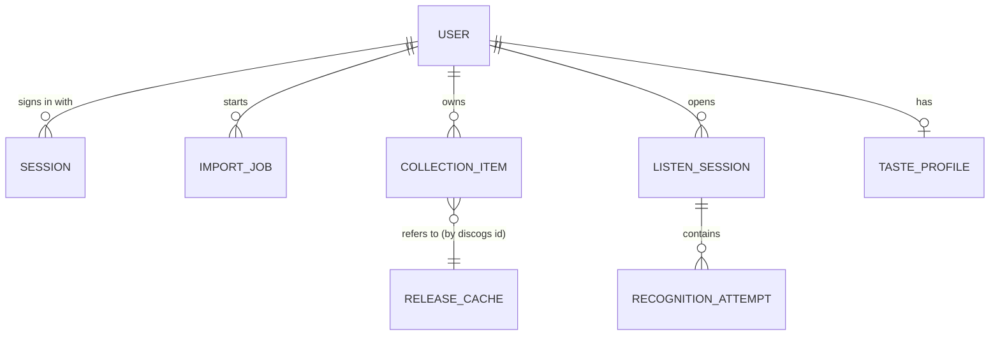
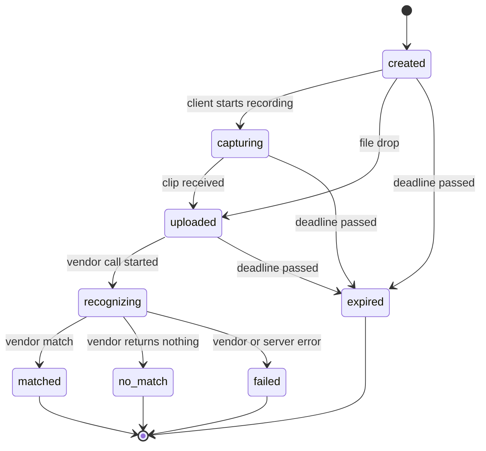

# Domain model

## Entities

| Entity | Persisted? | Notes |
|---|---|---|
| **User** | Yes | Our account, keyed to a Discogs username. OAuth tokens stored encrypted at rest. |
| **Session** | Yes (short-lived) | A signed-in browser. Only a hash of the cookie value is stored, so logout revokes it (ADR 0006). |
| **ImportJob** | Yes | One per collection import; holds status and a checkpoint cursor so it can resume. |
| **CollectionItem** | Reference only | Shelf reference: Discogs instance ID, release ID and date added. Release contents are refreshed, not kept past the TTL (ADR 0004); items gone from Discogs are deleted on each import (ADR 0006). |
| **Release** | Cache only | Discogs metadata with classification, `fetched_at`, `expires_at`. |
| **ListenSession** | Yes (short-lived) | Groups attempts for one client; reserved attach point for phone pairing. |
| **RecognitionAttempt** | Yes | State machine below. Audio itself is never stored. |
| **TasteProfile** | Yes (later) | Derived from the user's shelf; built from data we are allowed to keep. |

## RecognitionAttempt state machine

Rules:

- Terminal states: `matched`, `no_match`, `failed`, `expired`. No transitions out.
- Every non-terminal attempt has an `expiresAt`; a sweeper moves overdue attempts to
  `expired`.
- Each transition emits one event on the attempt's SSE stream (ADR 0002).
- `paired_phone` is a valid `source` in the schema but rejected until the feature ships.
- Uploading audio is only valid in `created` or `capturing`; otherwise the API returns 409.
